# Arrive Aruba · e-actividad 3.2 — Frontend

[](https://github.com/mmorfe-engineer/morfemartin-arrive-aruba-uvm-frontend-3.2/actions/workflows/validate.yml)
[](https://github.com/mmorfe-engineer/morfemartin-arrive-aruba-uvm-frontend-3.2/actions/workflows/deploy-pages.yml)
[](https://mmorfe-engineer.github.io/morfemartin-arrive-aruba-uvm-frontend-3.2/)
[](https://www.figma.com/design/yYdy306Qxg2WYFEjMPX2GZ/Arrive-Aruba-%C2%B7-e-actividad-3.2-ENTREGA?node-id=0-1&t=HSJnSwA2ba5aAUgo-1)


Sitio web de la marca de ropa resort **Arrive Aruba**: seis páginas responsivas
(inicio, catálogo, producto, formulario de reserva, nosotros y mis pedidos)
empaquetadas con **webpack**, que minifica el HTML y el CSS de producción.

Adaptación académica de la identidad de la marca para la e-actividad 3.2 de la
cátedra de Front End.

**Autores:** Martin Morfe Flores · Martin Alejandro Morfe Carballo
**Universidad Valle del Momboy** · Cátedra de Front End · Profesor: Ing. Anggelo Huz

**Sitio publicado (GitHub Pages):** https://mmorfe-engineer.github.io/morfemartin-arrive-aruba-uvm-frontend-3.2/
**Diseño en Figma:** [Arrive Aruba · e-actividad 3.2](https://www.figma.com/design/yYdy306Qxg2WYFEjMPX2GZ/Arrive-Aruba-%C2%B7-e-actividad-3.2-ENTREGA?node-id=0-1&t=HSJnSwA2ba5aAUgo-1)

---

## Requisitos

- **Node.js 18 o superior** (con npm). Comprueba tu versión con `node --version`.
- Git (solo para clonar el repositorio).
- Para ver el sitio localmente hace falta **un servidor local** (incluido en los
  comandos de abajo). Abierto directo con doble clic (`file://`), el hero no
  carga su manifiesto por seguridad del navegador.

## Ejecución paso a paso

1. **Clonar el repositorio**

   ```sh
   git clone https://github.com/mmorfe-engineer/morfemartin-arrive-aruba-uvm-frontend-3.2.git
   cd morfemartin-arrive-aruba-uvm-frontend-3.2
   ```

2. **Instalar las dependencias** (solo la primera vez; tarda unos minutos)

   ```sh
   npm install
   ```

3. **Servidor de desarrollo** (recarga al guardar)

   ```sh
   npm run dev
   ```

   Abre http://localhost:9000 — se abre solo. Para detenerlo: `Ctrl+C`.

4. **Build de producción** — genera `dist/` con el **HTML y el CSS minificados**

   ```sh
   npm run build
   ```

   Salida en `dist/`: las 6 páginas en `dist/*.html`, un CSS minificado por
   página en `dist/css/`, y los assets y scripts copiados a `dist/assets/` y
   `dist/js/`.

5. **Previsualizar el build** (sirve `dist/` como lo haría el hosting)

   ```sh
   npm run preview
   ```

   Abre http://localhost:8000. Para detenerlo: `Ctrl+C`.

## Estructura del proyecto

```
├── index.html · catalogo.html · producto.html      páginas del sitio
│   formulario.html · nosotros.html · historial.html
├── css/          hojas de estilo por página + base + componentes + responsive
├── js/           lógica del sitio (bd, formulario, historial) y del hero
├── assets/       imágenes de la marca y láminas del hero (assets/journey/)
├── docs/figma    láminas de diseño: tokens, wireframes y mockups (SVG)
├── dist/         build de producción (generado, no se versiona)
├── package.json  dependencias y scripts (dev · build · preview)
└── webpack.config.js
```

## Qué hace webpack

- **HTML minificado** por página (`html-webpack-plugin`): espacios y
  comentarios fuera en `dist/`.
- **CSS unido y minificado** por página (`css-loader` +
  `mini-css-extract-plugin` + `css-minimizer-webpack-plugin`): de las 4–6
  hojas por página queda un solo archivo comprimido en `dist/css/`.
- **Assets y scripts copiados** tal cual (`copy-webpack-plugin`).

## Características de la 3.2

- **Responsive** en las seis páginas con puntos de quiebre en CSS puro;
  **menú desplegable** tipo hamburguesa sin JavaScript (checkbox + label).
- **Carrusel** de editoriales con scroll-snap (CSS puro, encaje al centro).
- **Parallax al scroll**: banda a pantalla completa con fondo fijo (CSS puro),
  respetando `prefers-reduced-motion`.
- **Acordeón** de ficha técnica con `<details>/<summary>` (nativo, accesible).
- **Hero «Journey Organic»**: la ventana del avión de la marca reproduce una
  secuencia de fotogramas dirigida por el scroll (canvas + manifiesto de
  láminas), con póster estático de respaldo y soporte de conexión lenta.
- Accesibilidad: enlace para saltar al contenido, `aria-labels`,
  `prefers-reduced-motion`, contraste cuidado en la paleta.

## Diseño en Figma

El diseño de la e-actividad se documentó en Figma con los tres entregables
pedidos: **wireframes en mobile**, **mockups en mobile** y **diseño en
escritorio y mobile**. Las láminas de este capítulo viven también como archivos
vectoriales en la carpeta [`docs/figma/`](docs/figma) del repositorio; cada
tarjeta muestra la vista superior de la página y el enlace abre el diseño
completo con todas sus secciones.

**Archivo de Figma (editable, por capas):** [Arrive Aruba · e-actividad 3.2](https://www.figma.com/design/yYdy306Qxg2WYFEjMPX2GZ/Arrive-Aruba-%C2%B7-e-actividad-3.2-ENTREGA?node-id=0-1&t=HSJnSwA2ba5aAUgo-1)

### Design tokens

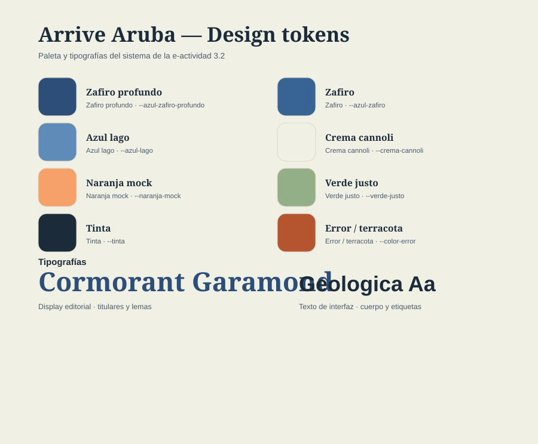

**Figura 1 — Design tokens.** Paleta del sistema con su variable CSS
(`--azul-zafiro-profundo`, `--azul-lago`, `--crema-cannoli`, `--naranja-mock`,
`--verde-justo`, `--tinta` y `--color-error`) y la pareja tipográfica:
*Cormorant Garamond* para el display editorial y *Geologica* para la interfaz.
[Ver hoja completa](docs/figma/0-tokens-diseno.svg)

### Wireframes y mockups mobile — comparación por página

<table>
  <tr><th>Página</th><th>Wireframe · baja fidelidad</th><th>Mockup · alta fidelidad</th></tr>
  <tr>
    <td>Inicio</td>
    <td>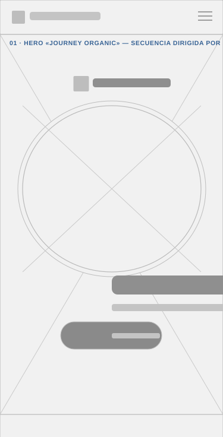<br/><b>Figura 2 — Wireframe · Inicio.</b> Cabecera, hero «Journey Organic» con la ventana del avión, banda de atmósfera y rejilla de destacados 2 × 2.<br/><a href="docs/figma/1-wireframes-mobile/01-inicio-wireframe-mobile.svg">Diseño completo (SVG)</a></td>
    <td>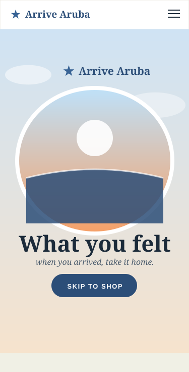<br/><b>Figura 8 — Mockup · Inicio.</b> El mismo hero con la paleta y las tipografías del sistema: ventana con el atardecer, titular «What you felt» y CTA «Skip to shop».<br/><a href="docs/figma/2-mockups-mobile/01-inicio-mockup-mobile.svg">Diseño completo (SVG)</a></td>
  </tr>
  <tr>
    <td>Catálogo</td>
    <td>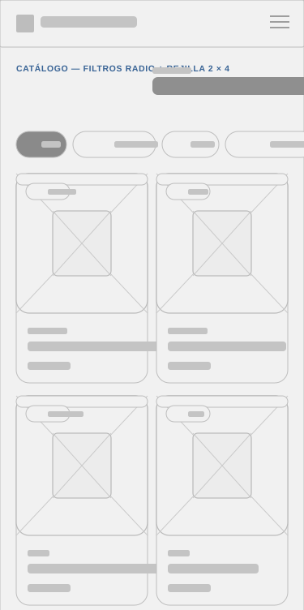<br/><b>Figura 3 — Wireframe · Catálogo.</b> Filtros de categoría y rejilla de tarjetas de prenda en dos columnas.<br/><a href="docs/figma/1-wireframes-mobile/02-catalogo-wireframe-mobile.svg">Diseño completo (SVG)</a></td>
    <td>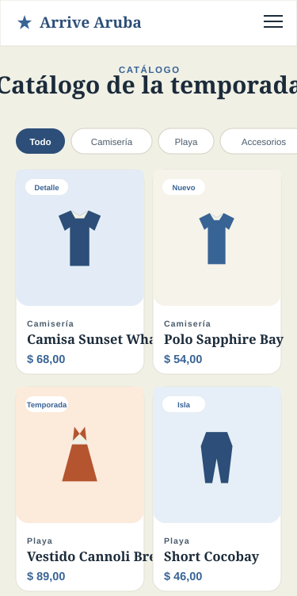<br/><b>Figura 9 — Mockup · Catálogo.</b> Chips de filtro (Todo, Camisería, Playa, Accesorios, Calzado) y tarjetas con etiqueta, nombre y precio.<br/><a href="docs/figma/2-mockups-mobile/02-catalogo-mockup-mobile.svg">Diseño completo (SVG)</a></td>
  </tr>
  <tr>
    <td>Producto</td>
    <td>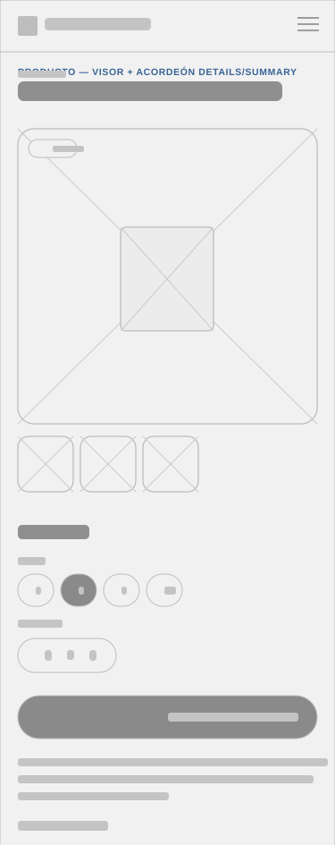<br/><b>Figura 4 — Wireframe · Producto.</b> Visor de la prenda, selectores de talla y cantidad, y el acordeón de la ficha técnica.<br/><a href="docs/figma/1-wireframes-mobile/03-producto-wireframe-mobile.svg">Diseño completo (SVG)</a></td>
    <td>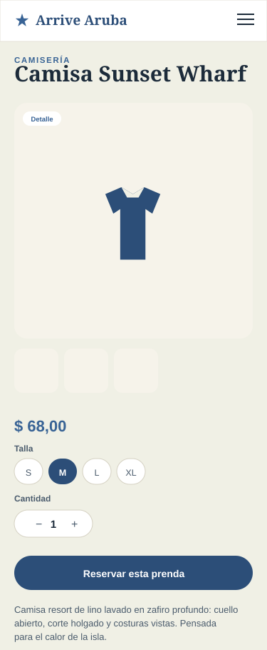<br/><b>Figura 10 — Mockup · Producto.</b> Galería con etiqueta «Detalle», talla S–XL, contador de cantidad y el acordeón <code>details/summary</code> de la ficha.<br/><a href="docs/figma/2-mockups-mobile/03-producto-mockup-mobile.svg">Diseño completo (SVG)</a></td>
  </tr>
  <tr>
    <td>Formulario</td>
    <td>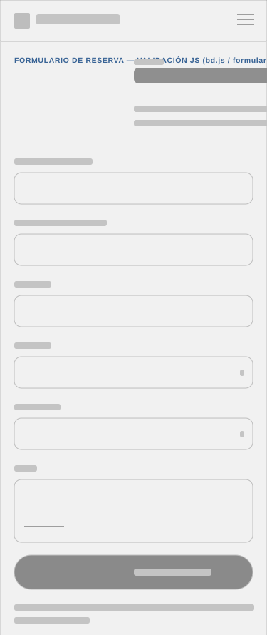<br/><b>Figura 5 — Wireframe · Reserva.</b> Campos del formulario de reserva y la secuencia de pasos de confirmación.<br/><a href="docs/figma/1-wireframes-mobile/04-formulario-wireframe-mobile.svg">Diseño completo (SVG)</a></td>
    <td>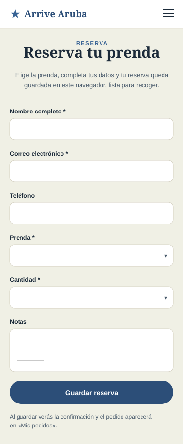<br/><b>Figura 11 — Mockup · Reserva.</b> Formulario completo (nombre, correo, teléfono, prenda, cantidad, notas) con el botón «Guardar reserva».<br/><a href="docs/figma/2-mockups-mobile/04-formulario-mockup-mobile.svg">Diseño completo (SVG)</a></td>
  </tr>
  <tr>
    <td>Nosotros</td>
    <td>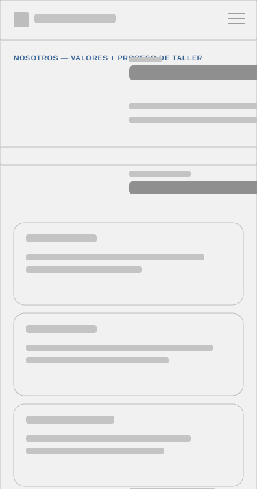<br/><b>Figura 6 — Wireframe · Nosotros.</b> Bloques de valores y la línea de proceso «del boceto al paquete».<br/><a href="docs/figma/1-wireframes-mobile/05-nosotros-wireframe-mobile.svg">Diseño completo (SVG)</a></td>
    <td>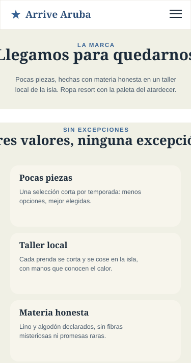<br/><b>Figura 12 — Mockup · Nosotros.</b> Los tres valores (pocas piezas, taller local, materia honesta) sobre tarjetas crema.<br/><a href="docs/figma/2-mockups-mobile/05-nosotros-mockup-mobile.svg">Diseño completo (SVG)</a></td>
  </tr>
  <tr>
    <td>Mis pedidos</td>
    <td>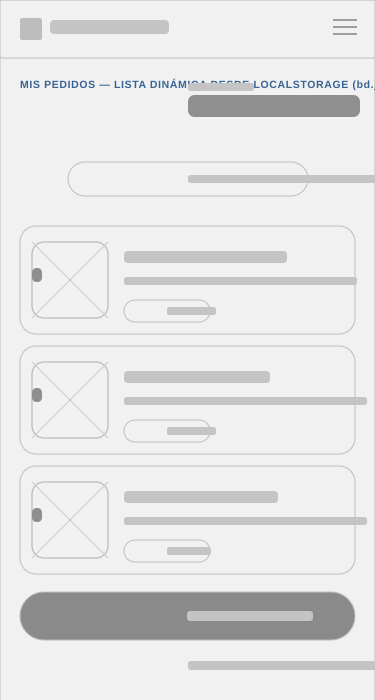<br/><b>Figura 7 — Wireframe · Mis pedidos.</b> Lista dinámica de pedidos con sus estados y el llamado a reservar de nuevo.<br/><a href="docs/figma/1-wireframes-mobile/06-historial-wireframe-mobile.svg">Diseño completo (SVG)</a></td>
    <td>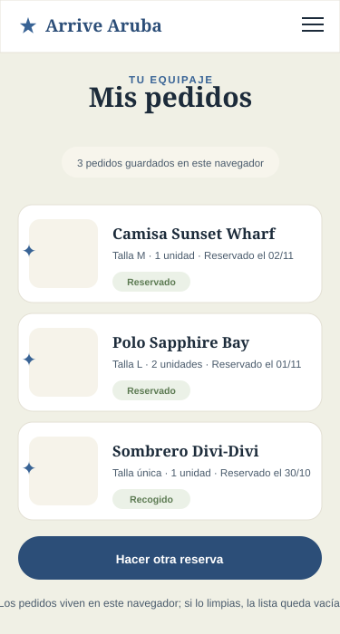<br/><b>Figura 13 — Mockup · Mis pedidos.</b> Pedidos guardados en el navegador con estado (Reservado / Recogido) y pie de créditos.<br/><a href="docs/figma/2-mockups-mobile/06-historial-mockup-mobile.svg">Diseño completo (SVG)</a></td>
  </tr>
</table>

### Mockups de escritorio

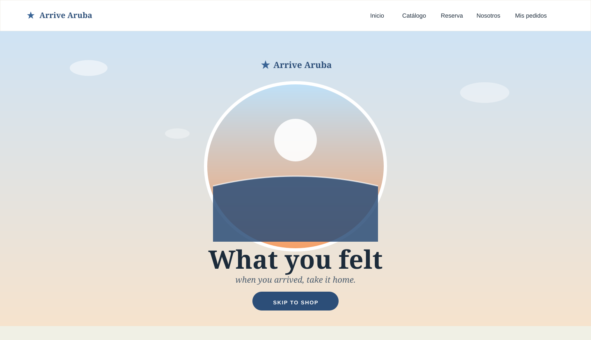

**Figura 14 — Mockup de escritorio · Inicio.** Navegación superior completa y
hero a pantalla con la ventana del avión; debajo queda la banda «The island
stays with you».
[Ver diseño completo](docs/figma/3-mockups-desktop/01-inicio-mockup-desktop.svg)

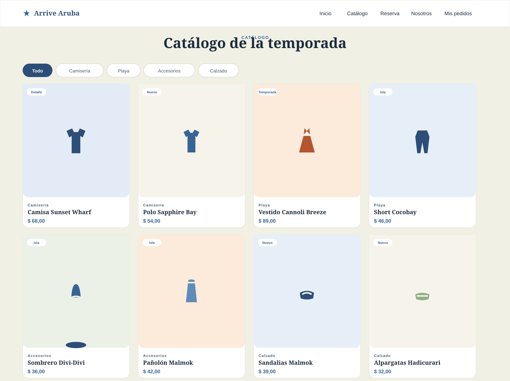

**Figura 15 — Mockup de escritorio · Catálogo.** Filtros arriba y ocho
tarjetas de prenda en dos filas de cuatro.
[Ver diseño completo](docs/figma/3-mockups-desktop/02-catalogo-mockup-desktop.svg)

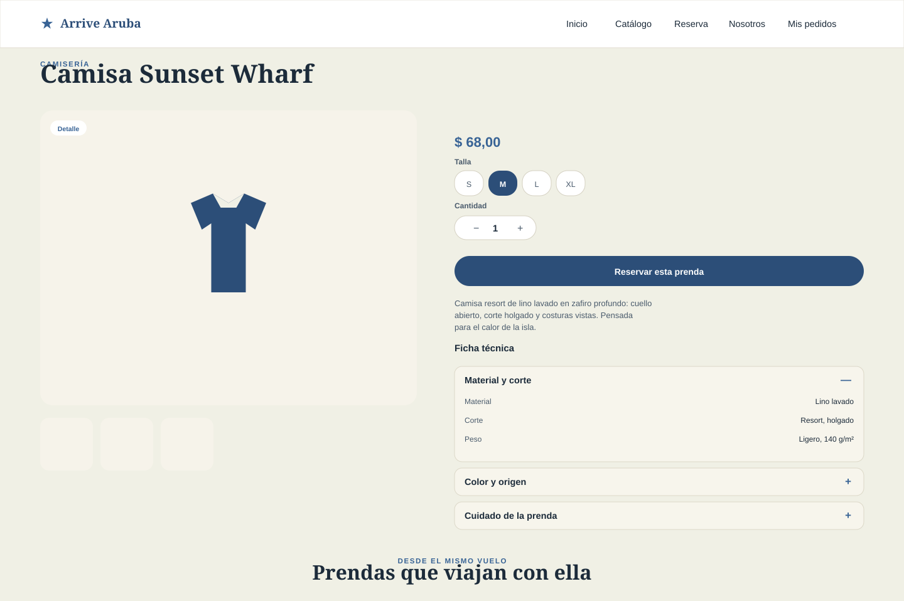

**Figura 16 — Mockup de escritorio · Producto.** Dos columnas: visor de la
prenda a la izquierda; talla, cantidad, descripción y ficha técnica con
acordeón a la derecha.
[Ver diseño completo](docs/figma/3-mockups-desktop/03-producto-mockup-desktop.svg)

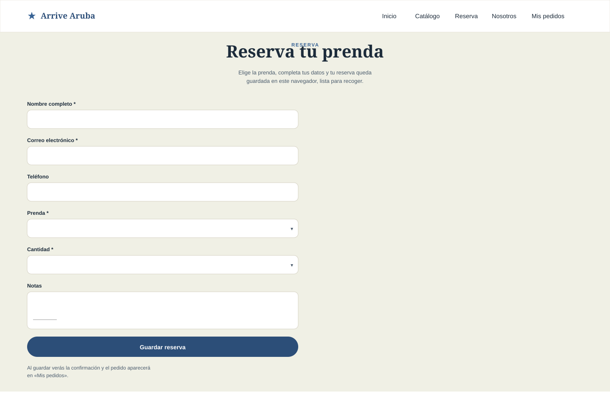

**Figura 17 — Mockup de escritorio · Reserva.** Formulario centrado con su
aviso de confirmación; los pasos «Cómo funciona tu reserva» siguen en la
lámina completa.
[Ver diseño completo](docs/figma/3-mockups-desktop/04-formulario-mockup-desktop.svg)

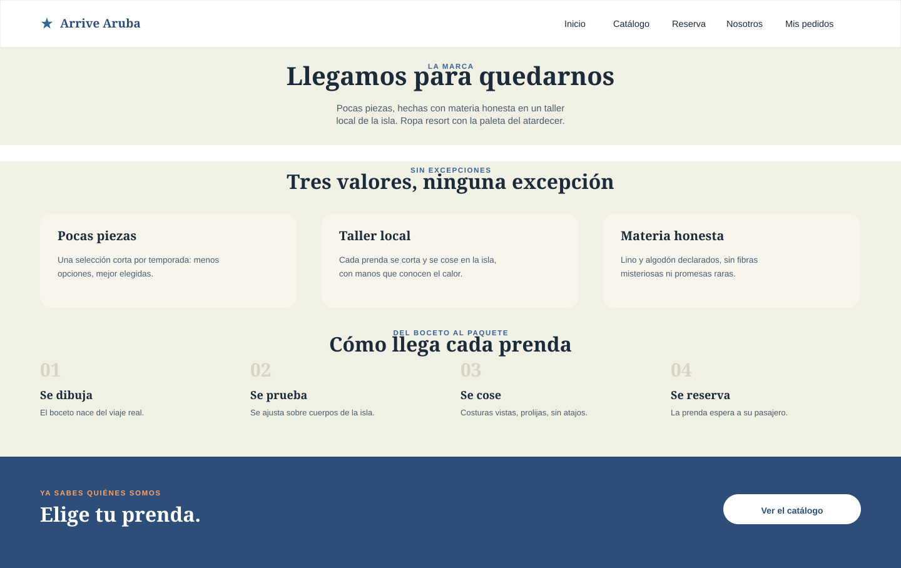

**Figura 18 — Mockup de escritorio · Nosotros.** Cabecera de marca, los tres
valores en columnas y la línea de tiempo del proceso de entrega.
[Ver diseño completo](docs/figma/3-mockups-desktop/05-nosotros-mockup-desktop.svg)

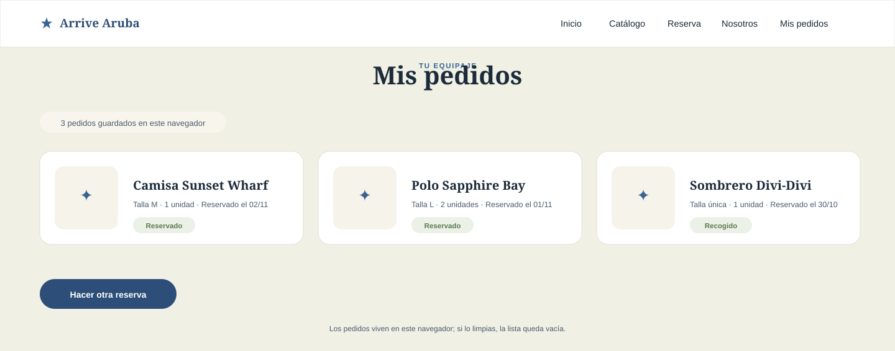

**Figura 19 — Mockup de escritorio · Mis pedidos.** Las tres tarjetas de
pedido en fila con sus estados y el pie con los créditos de la cátedra.
[Ver diseño completo](docs/figma/3-mockups-desktop/06-historial-mockup-desktop.svg)

## Despliegue

El sitio se publica en **GitHub Pages** automáticamente con GitHub Actions:
cada push a `main` ejecuta `npm run build` y publica `dist/` —el build con HTML
y CSS minificados— en:

**https://mmorfe-engineer.github.io/morfemartin-arrive-aruba-uvm-frontend-3.2/**

El workflow `validate.yml` compila el sitio en cada push y pull request para
asegurar que el build siempre pasa.

## Créditos

Proyecto académico sin fines comerciales. Tipografías: Cormorant Garamond y
Geologica (Google Fonts). Sin plantillas: HTML, CSS y JavaScript escritos
para esta entrega.
